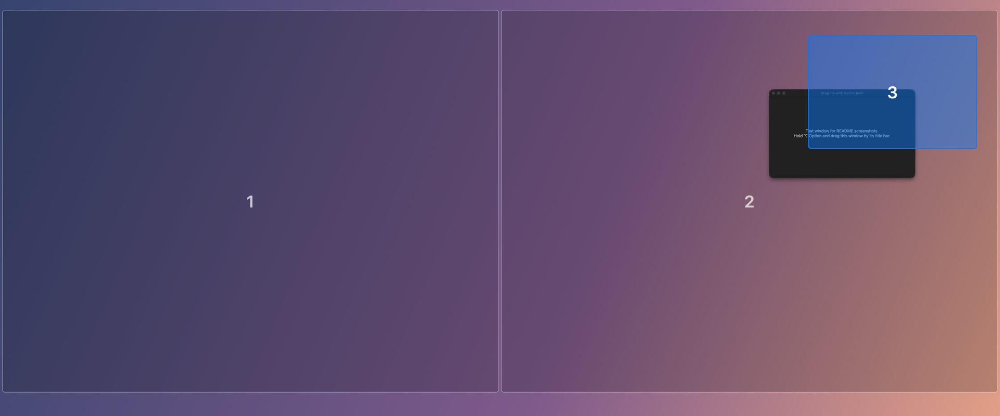
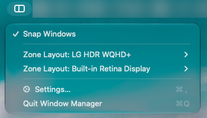
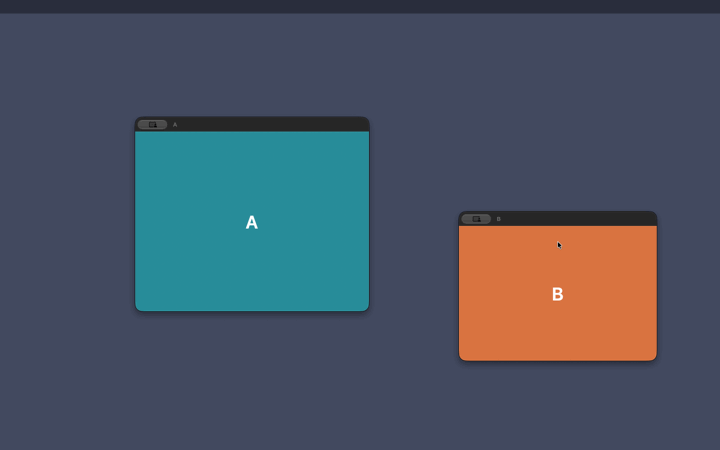
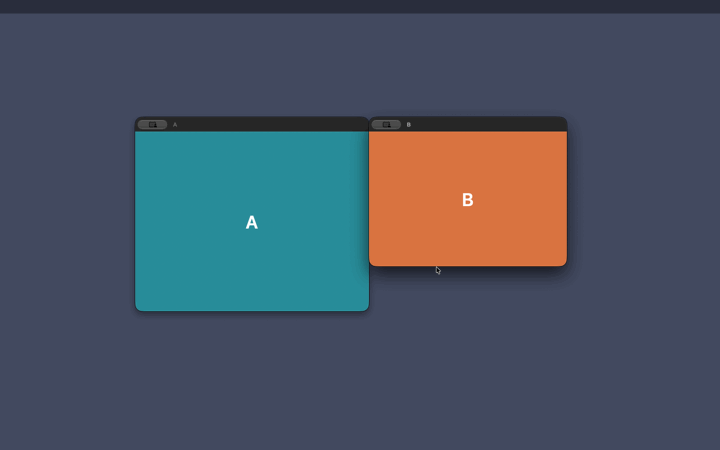
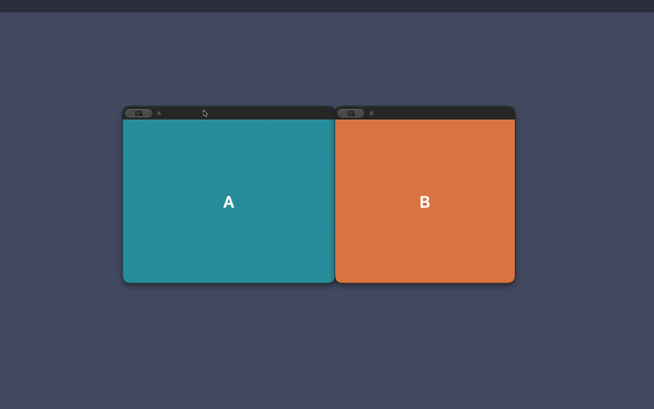
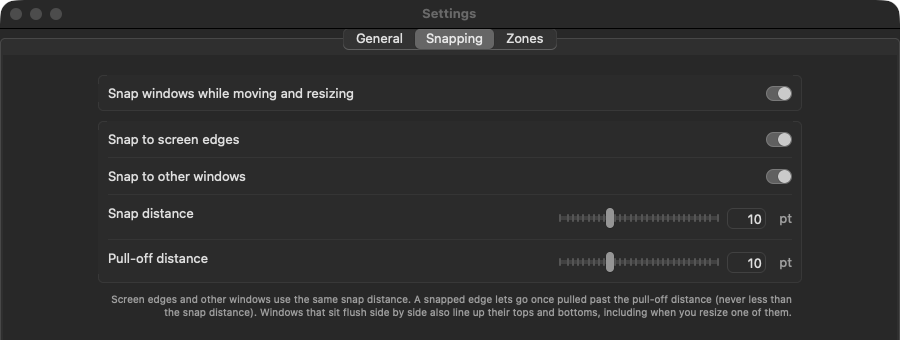
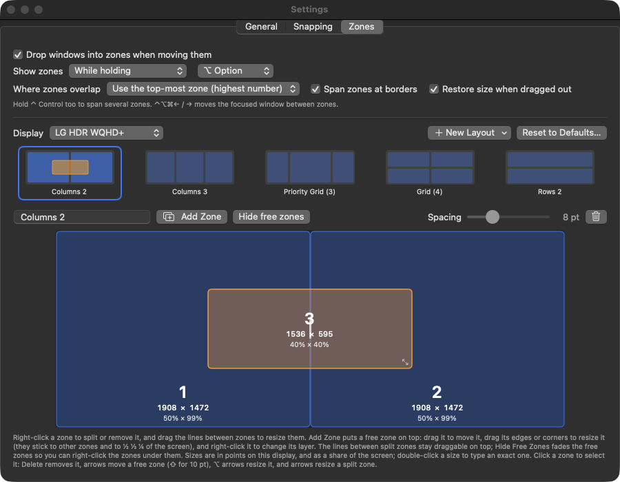
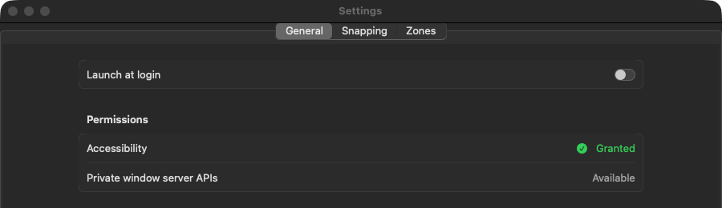

# macOS Window Manager

A menu bar window manager for macOS 14+, written in Swift (SwiftUI + AppKit) with no third-party
dependencies. Windows snap to screen edges and to each other as you move and resize them, the way
KWin does, and you can drop them into zone layouts you design yourself, like FancyZones.



## Features

- **Edge, window and centre snapping** while you move *and* resize, with a distance per zone and a
  KWin-style release at the same distance. Hold ⌘ Command (configurable) mid-drag to place a window freely.
- **Zones**: hold ⌥ Option while dragging a window to show the display's zones and drop it into
  one. Span several zones, overlap zones on layers, and get the window's old size back when you
  drag it out.
- **Layout editor** in Settings › Zones, with templates, split and free zones, editable sizes,
  rulers and keyboard nudging.
- **Per-display layouts**, picked from the menu bar.
- **⌃⌥⌘← / →** moves the focused window to the previous or next zone, and on to the next display.

## Requirements

- macOS 14 Sonoma or later
- Xcode (for `xcodebuild`) to build it
- Accessibility permission, which the app asks for on first launch

## Build and run

```bash
scripts/build-app.sh --run       # build "build/Window Manager.app" and launch it
scripts/build-app.sh --install   # build, copy to /Applications, launch
scripts/build-app.sh --test      # unit tests (xcodebuild test)
```

On first launch the app asks for Accessibility access and closes the prompt by itself once it is
granted. The app is signed with a stable local identity when one is in the keychain ("Automator
Local Signing", then "Apple Development"), so the grant survives rebuilds; set `SIGN_IDENTITY` to
override. Opening the app again while it runs shows Settings, which helps when the menu bar icon
is hidden behind the notch.

The executable is `WindowManagerApp`, not `WindowManager`: macOS already runs a system process
called `WindowManager` (Stage Manager), so never `pkill -x WindowManager`.

## Using it

### Menu bar



The menu bar menu turns snapping on and off, picks the zone layout for each connected display,
and opens Settings.

### Snapping

**Snap to a window**: B snaps flush against A, and its top lines up with A's so the corners meet.



**Resize**: dragging B's bottom edge near A's bottom snaps them to the same height.



**Screen corner**: A snaps into the top-left corner, against the menu bar and the screen edge.



While you move or resize a window, it snaps to targets in three zones, each with its own
distance (as in KWin):

- **Screen edges** (10 pt by default): the edges of the screen's usable area.
- **Other windows** (10 pt by default): the facing edge of a neighbouring window, so windows sit
  flush side by side or stacked; and, once flush, the same edge of that window, so the tops and
  bottoms of side-by-side windows (and the sides of stacked windows) line up and corners meet.
- **Screen centre** (off by default, 10 pt): a moved window centres on the screen when its centre
  comes close on both axes, or centres along a screen edge it is snapped to.

Like KWin, snapping is worked out afresh on every mouse movement: the nearest target within its
zone's distance wins, and an edge lets go at the same distance it caught. When resizing, only the edge you drag snaps: drag the bottom of the shorter
of two side-by-side windows near the other's bottom and they end up the same height.

To put a window a few points from an edge or another window, hold ⌘ Command while you move or
resize it: snapping stops for as long as the key is down, and picks up again when you let go, even
mid-drag. The key is set in Settings › Snapping (or "No key"); it can't be the zone key.



### Zones



Each display has its own zone layout. Hold ⌥ Option while moving a window to show the zones, and
release over one to drop the window into it. Settings › Zones can change the key to Shift, Command
or Control, or show the zones on every drag (holding the key then hides them).

- **Span zones**: hover the border between two zones to fill both. Hold ⌃ Control as well (⇧ Shift
  when Control is the zone key) to span every zone between where you pressed it and the cursor.
- **Overlapping zones**: free zones sit on layers above the split zones. Where zones overlap, the
  top-most one (highest number) wins by default; you can switch to the smallest zone or the one
  whose centre is closest.
- **Drag out**: a window dragged out of a zone gets its previous size back (can be turned off).
- **Keyboard**: ⌃⌥⌘← / → moves the focused window to the previous / next zone, continuing onto the
  next display.

### Layout editor

Settings › Zones lists the layouts for the chosen display. The templates (Columns, Rows, Grid,
Priority Grid) and your own layouts all edit the same way:

- **Right-click** a zone to split it side by side or top and bottom, or to remove it.
- **Drag the lines** between split zones to resize them.
- **Add Zone** puts a free zone on top. Drag it to move it, and drag its edges or corners to resize
  it; they stick to other zones and to ½, ⅓ and ¼ of the screen. Right-click it to bring it
  forward or send it back. **Hide free zones** fades them so you can reach the zones underneath.
- Each zone shows its size in points and as a share of the screen, and rulers show the distances
  around the zone you drag or point at.
  **Double-click a size** to type an exact one.
- **Click** a zone to select it, then press **Delete** to remove it, **arrow keys** to move a free
  zone (⇧ for 10 pt steps), **⌥ arrows** to resize it, or arrows to resize a split zone.
- **New Layout** starts from a number of zones or duplicates the current layout, and
  **Reset to Defaults…** deletes your custom layouts.

### General



Launch at login, and the state of the Accessibility permission and the private window server APIs
the app uses where available.

## Roadmap

| Phase | Status |
|---|---|
| 1. Foundation: menu bar app, onboarding, window control, settings | Done |
| 2. Snapping | Done |
| 3. Zones: predefined layouts and editor | Done |
| 4. Multiple displays and Spaces | Planned |
| 5. Save and restore window positions | Planned |
| 6. Auto-tiling | Planned |

## Development

### Debug commands

The executable doubles as a CLI that uses the calling terminal's Accessibility grant:

```bash
B="build/Window Manager.app/Contents/MacOS/WindowManagerApp"
"$B" --status                         # permission and private API availability
"$B" --list-windows [--all]           # windows on the current Space
"$B" --list-displays                  # displays, visible frames in AX coordinates
"$B" --list-spaces                    # Spaces per display (SkyLight)
"$B" --snap 1234 [distance]           # snap a window by number as if it had just been moved
```

To see how a drag performs (event tap time, placements per second, how often a window was slow to
get where it was put), turn on the drag trace and relaunch the app:

```bash
defaults write io.marky.windowmanager traceDrag -bool YES
log stream --predicate 'subsystem == "io.marky.windowmanager"' --level info
```

### Source layout

```
Sources/WindowManagerCore/      no UI; everything testable and reused by later phases
  Geometry/   ScreenCoordinates (AppKit <-> AX flip)
  Windows/    Window handle, AX helpers, WindowControlling + WindowService, WindowList (CGWindowList)
  Snapping/   SnapEngine (pure snap math), SnapController (mouse drag monitor that applies it)
  Zones/      ZoneLayout (split tree + templates), ZonePicker, ZoneStore, ZoneOverlay, ZoneController
  Displays/   Display (frames already in AX space), DisplayService
  Private/    SkyLight via dlsym (focus, Spaces) and _AXUIElementGetWindow
  Hotkeys/    KeyCombo, HotkeyCenter (Carbon RegisterEventHotKey)
  Settings/   SettingsStore (UserDefaults, observable)
  Permissions/AccessibilityPermission (polls until granted)
Sources/WindowManagerApp/       menu bar app: status item, onboarding, settings, debug CLI
Tests/WindowManagerCoreTests/
```

Conventions:

- **One coordinate space.** Everything is in AX space (top-left of the primary display, y down).
  AppKit frames are converted once, in `DisplayService`.
- **Window identity is the CG window number** (`Window.windowID`), which is stable across Spaces.
- **Private APIs are optional.** SkyLight symbols are resolved at runtime; if one disappears the
  code falls back to public API rather than crashing.
- **Layouts are split trees** (`ZoneNode`) plus a list of free zones, assigned per display UUID in
  `ZoneStore`.

How later phases build on this:

| Phase | Builds on |
|---|---|
| 4. Multiple displays and Spaces | `DisplayService`, `SkyLight.managedDisplaySpaces` / `spaces(for:)` |
| 5. Save and restore | `Window.windowID` + app bundle id as keys; persisted beside `SettingsStore` |
| 6. Auto-tiling | `WindowControlling`; window created/destroyed observers |

## License

Released under the [MIT License](LICENSE). Copyright (c) 2026 Mark Espiritu.

The project has no GPL code or dependencies.
